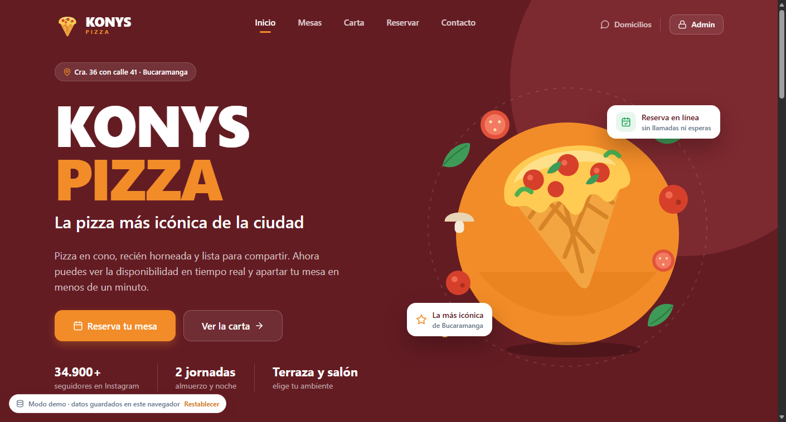
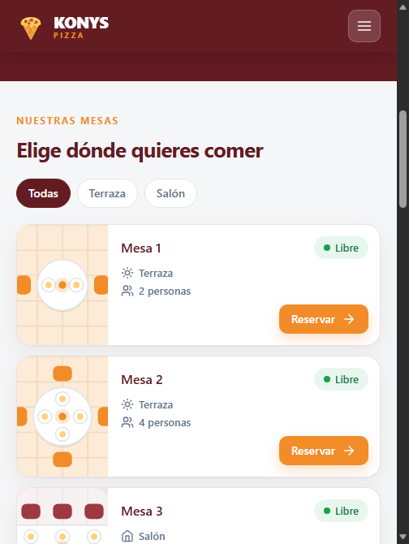
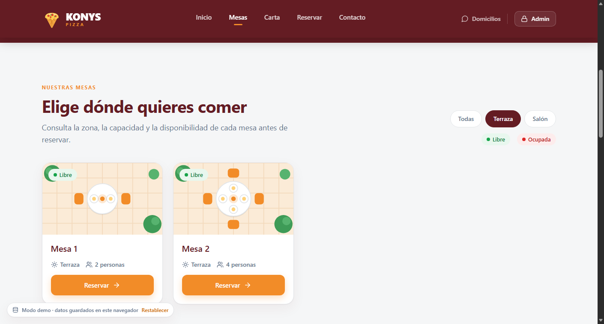
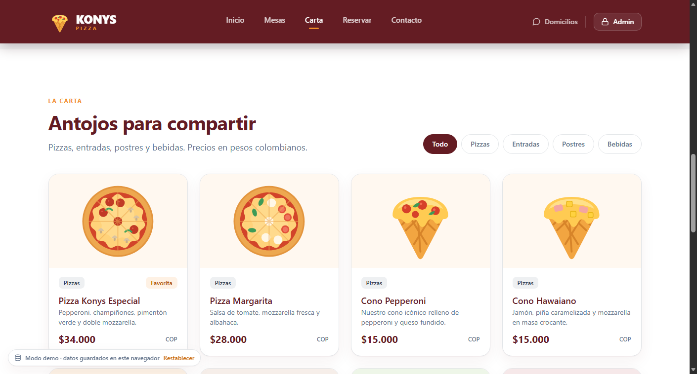
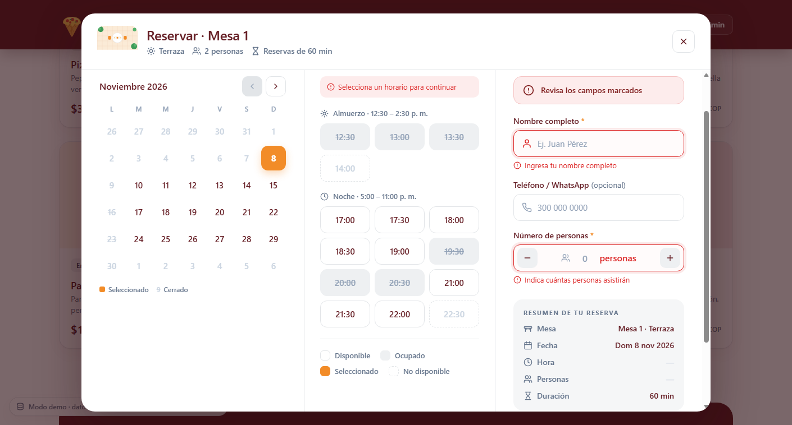
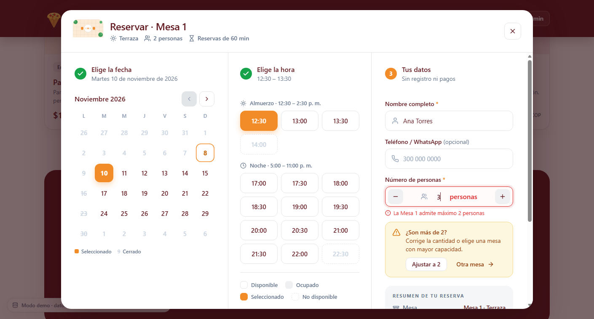
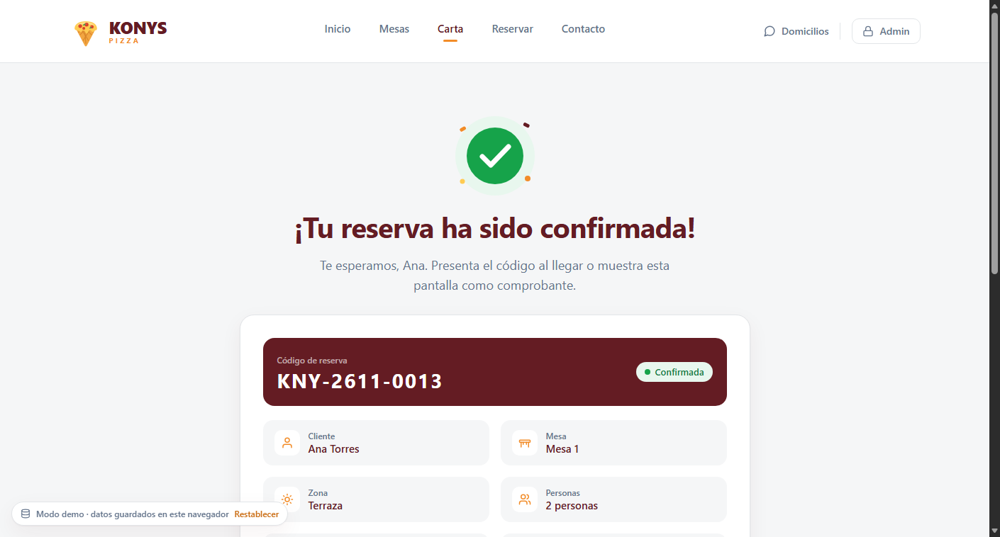
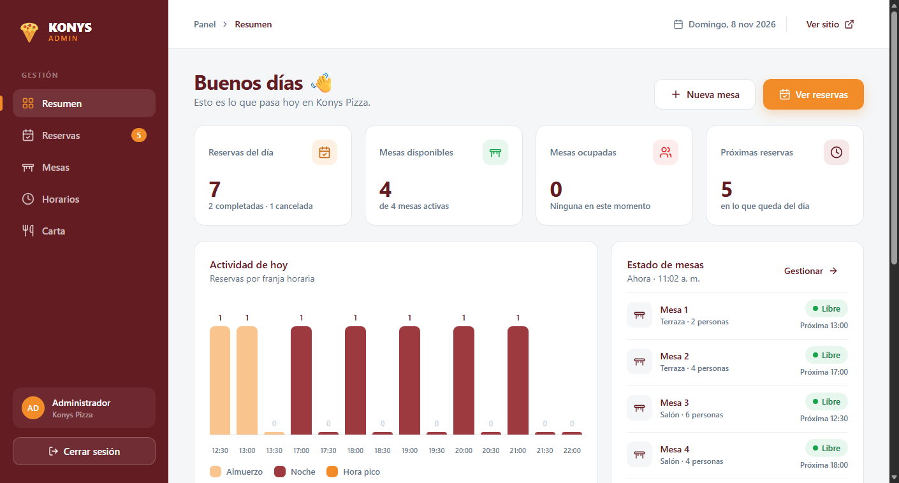
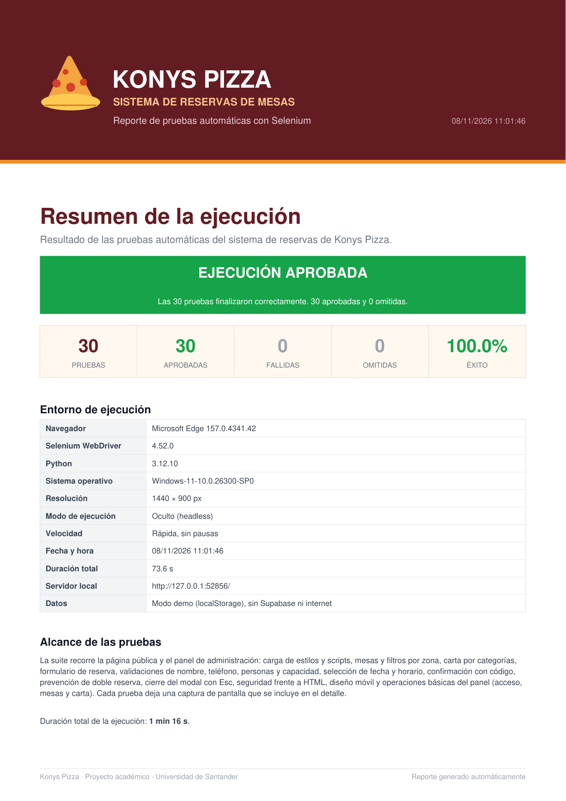

# Konys Pizza · Sistema de Reservas de Mesas

Aplicación web para que los clientes de **Konys Pizza** (Cra. 36 con calle 41, Bucaramanga) consulten la disponibilidad de mesas y reserven en línea, y para que el administrador gestione mesas, horarios, reservas y la carta digital.

Proyecto académico · Universidad de Santander.

- **Aplicación desplegada:** _pendiente (URL de Vercel)_
- **Video explicativo:** _pendiente (enlace de YouTube o Drive)_

## Tecnologías

| Tecnología | Uso |
|---|---|
| HTML5, CSS3, JavaScript ES6+ (vanilla) | Interfaz, estilos responsive y lógica del cliente |
| Supabase (SDK JS v2) | Base de datos: mesas, horarios, reservas y platos |
| Vercel | Despliegue continuo desde GitHub |
| Figma | Diseño de alta fidelidad (`KONYS.fig`) |
| Python 3 + Selenium WebDriver | Pruebas automáticas end-to-end en Chrome o Edge |
| ReportLab | Generación del reporte PDF de las pruebas |

## Estructura

```
konys-reservas-app/
├── index.html            # Página principal (cliente): mesas, reserva, confirmación, carta
├── admin.html            # Panel de administración (/admin en Vercel)
├── css/styles.css        # Design System (tokens del Figma) + componentes + responsive
├── js/
│   ├── config.js         # URL y anon key. En git va vacío. Lo cargan las dos páginas
│   ├── admin-config.js   # Contraseña del panel. Solo lo carga admin.html
│   ├── validacion.js     # Reglas compartidas por la interfaz y la capa de datos
│   ├── ui.js             # Iconos, ilustraciones, formatos, generación de horarios
│   ├── supabase.js       # Conexión con Supabase (o modo demo local)
│   ├── cliente.js        # Lógica del módulo cliente
│   └── admin.js          # Lógica del módulo administrador
├── supabase/schema.sql   # Tablas, reglas RLS, índice anti doble reserva y datos iniciales
├── scripts/build-config.js # Vuelca .env o las variables de Vercel a js/config.js
├── pruebas/
│   ├── pruebas_reservas.py # Suite de 30 pruebas Selenium + servidor local en modo demo
│   ├── reporte_pdf.py      # Generador del reporte PDF (portada, resumen y detalles)
│   └── requirements.txt    # selenium, reportlab
├── ejecutar_pruebas.bat  # Lanzador de Windows: instala dependencias si faltan y ejecuta
├── .env.example          # Plantilla de variables (copiar como .env)
├── docs/
│   ├── Documento-Proyecto.pdf
│   └── capturas/         # Capturas de la app y portada del reporte para este README
├── vercel.json
└── .gitignore            # Ignora .env, no js/config.js
```

## Ejecutar en local

El modo demo no necesita claves. `js/config.js` ya está en el repositorio con `SUPABASE_URL` y `SUPABASE_ANON_KEY` vacías. La contraseña del panel está en `js/admin-config.js`, que la página pública no carga.

1. Abre esta carpeta.
2. Abre `index.html` en el navegador (doble clic) o sírvela con un servidor estático.

Si `SUPABASE_URL` está vacío, la app funciona en **modo demo**: usa datos de ejemplo guardados en el navegador (localStorage) y muestra la etiqueta «Modo demo» abajo a la izquierda, con un botón para restablecer los datos. Así puedes probar todo sin backend.

- Panel de administración: `admin.html` · contraseña por defecto **`konys2026`**.

### Cuando tengas las claves

1. Copia `.env.example` como `.env` (ya puede existir, vacío).
2. Pega `SUPABASE_URL` y `SUPABASE_ANON_KEY` (la anon/public key, nunca la service_role). Si dejas `ADMIN_PASSWORD` vacío, el panel sigue usando `konys2026`.
3. Desde esta carpeta ejecuta `node scripts/build-config.js`. El script reescribe `js/config.js` (página pública, sin contraseña) y `js/admin-config.js` (solo el panel).
4. Recarga `index.html`. Si las dos claves de Supabase tienen valor, desaparece el modo demo.

`.env` no se sube a Git. `js/config.js` sí, pero solo como plantilla vacía: si el script escribió claves, no lo commitees así.

## Conectar Supabase

1. Crea un proyecto en [supabase.com](https://supabase.com).
2. En **SQL Editor → New query** pega todo `supabase/schema.sql` y pulsa **Run**. Crea las tablas, las reglas de seguridad (RLS), las funciones `crear_reserva` y `ocupacion_reservas`, y los datos iniciales. El script es idempotente: puedes volver a ejecutarlo, y si falla no aplica nada.
3. En **Project Settings → API** copia la *Project URL* y la *anon public key* en `.env` y ejecuta `node scripts/build-config.js`.

### Seguridad y panel de administración

- Los visitantes **no** pueden leer nombres ni teléfonos de las reservas ni modificar mesas, horarios o platos. Reservan con `crear_reserva()`, que valida en el servidor el horario, la capacidad, la mesa activa y la superposición.
- La contraseña que termina en `js/admin-config.js` **no es seguridad**: quien abre ese archivo la ve. Solo oculta la interfaz del panel y, en modo demo, la capa de datos vuelve a exigir esa sesión antes de mostrar teléfonos o guardar cambios. La página pública no carga ese archivo.
- Por eso, conectado a Supabase, el panel muestra un aviso y la base de datos rechaza sus cambios hasta que exista un inicio de sesión real con **Supabase Auth**. Los pasos están en la sección 7 de `schema.sql`. Para una presentación académica, la sección 8 trae un modo opcional sin autenticación, documentado como inseguro.
- El **modo demo** funciona igual que antes.

## Desplegar en Vercel

1. Sube el repositorio a GitHub. `.env` queda fuera por `.gitignore`. `js/config.js` sí va, con las claves vacías.
2. En Vercel: **Add New → Project →** importa el repositorio (framework: *Other*).
3. En **Settings → General → Root Directory** elige `konys-reservas-appw/konys-reservas-app`. Si la raíz queda en el repo, Vercel no ve `index.html` ni `vercel.json`.
4. En **Settings → Environment Variables** agrega `SUPABASE_URL`, `SUPABASE_ANON_KEY` y `ADMIN_PASSWORD`.
5. Vercel ejecuta `node scripts/build-config.js`. En el build manda `process.env` (no hace falta subir `.env`) y reescribe `js/config.js` y `js/admin-config.js`. El panel queda disponible en `/admin`. `vercel.json` añade cabeceras de seguridad (nosniff, anti-clickjacking y una CSP compatible con fuentes, el SDK y Supabase).

> La clave *anon* de Supabase es pública por diseño: la protección real la dan las reglas RLS de `schema.sql`. No uses nunca la *service_role key* en el front-end.

## Funcionalidades (trazabilidad)

| Requisito | Dónde |
|---|---|
| RF-01 Visualización de mesas (nombre, zona, capacidad, estado) | `index.html#mesas` · `cliente.js › renderMesas` |
| RF-02 Selección de mesa | Botón *Reservar / Ver horarios* → modal de reserva |
| RF-03 Elección de fecha (solo días habilitados) | Calendario (escritorio) y tira de días (móvil) |
| RF-04 Slots disponibles y ocupados | `ui.js › generarSlots` (cada 30 min según jornada y duración) |
| RF-05 Reserva con nombre, personas (≤ capacidad) y contacto opcional | Formulario + validaciones + `supabase.js › crearReserva` |
| RF-06 Confirmación con los datos y código | Vista *Reserva confirmada* (permite imprimir el comprobante) |
| RF-07 Carta por categorías (oculta los no disponibles) | `index.html#carta` |
| RF-08 Acceso con contraseña | `admin.html` |
| RF-09 / RF-10 Registro y listado de mesas | Panel › Mesas |
| RF-11 Horarios por día y duración | Panel › Horarios (con vista previa de slots) |
| RF-12 Reservas con filtros por fecha y mesa | Panel › Reservas |
| RF-13 Activar / desactivar mesas | Toggle en Panel › Mesas |
| RF-14 Agregar, editar, ocultar y eliminar platos | Panel › Carta |

**Estados de error contemplados:** horario tomado por otra persona antes de confirmar (verificación en el servidor + restricción de exclusión que impide reservas superpuestas), capacidad excedida, días u horarios sin disponibilidad, campos obligatorios y teléfono con formato inválido, contraseña incorrecta y validaciones en los formularios del panel.

**Responsive:** escritorio (≥ 1280 px), portátil, tablet (≤ 1023 px: menú hamburguesa y panel lateral desplegable) y móvil (≤ 639 px: tarjetas horizontales, reserva a pantalla completa con botón fijo, tablas con desplazamiento).

## Pruebas automatizadas (Selenium)

El proyecto incluye una suite de **30 pruebas end-to-end** con **Python + Selenium WebDriver** que recorre la página pública y el panel de administración, y genera un **reporte PDF** con portada, resumen y una ficha con captura por cada prueba.

Las pruebas levantan su propio servidor HTTP local y fuerzan el **modo demo**, así que no necesitan Supabase, claves ni conexión a internet. El navegador se detecta automáticamente: usa Chrome si está instalado y, si no, Microsoft Edge.

### Requisitos

- Python 3.8 o superior.
- Google Chrome o Microsoft Edge (Selenium 4 descarga el driver con Selenium Manager si hace falta).
- Dependencias de `pruebas/requirements.txt`: `selenium` y `reportlab`.

```bash
python -m pip install -r pruebas/requirements.txt
```

### Ejecución

Desde la raíz del proyecto:

```bash
# Windows: instala las dependencias si faltan y ejecuta las 30 pruebas
ejecutar_pruebas.bat

# O directamente con Python
python pruebas/pruebas_reservas.py

# Ejecución rápida y sin ventana (ideal para comprobar cambios o para CI)
python pruebas/pruebas_reservas.py --rapido --oculto --sin-abrir
```

| Opción | Efecto |
|---|---|
| `--rapido` | Quita las pausas y el efecto de tecleo. |
| `--oculto` | Ejecuta el navegador en modo headless. |
| `--sin-abrir` | No abre el PDF automáticamente al terminar. |
| `--navegador chrome` / `--navegador edge` | Fuerza un navegador concreto. |

El programa devuelve `0` si todas las pruebas pasan, `1` si hay fallos y `3` si no se pudo generar el reporte.

### Qué se prueba

| # | Grupo | Prueba | Verifica |
|---|---|---|---|
| 01 | Carga | La página principal carga | 4 mesas activas y el título de Konys Pizza. |
| 02 | Carga | Estilos y scripts disponibles | CSS, utilidades, validaciones y capa de datos cargadas en modo demo. |
| 03 | Carga | Carta y etiqueta de modo demo | 8 platos visibles y la etiqueta «Modo demo». |
| 04 | Carga | Cuadrícula de escritorio | Las mesas se distribuyen en 4 columnas a 1440 px. |
| 05 | Mesas | Filtro Terraza | Quedan 2 mesas, todas de Terraza. |
| 06 | Mesas | Filtro Salón | Quedan 2 mesas, todas de Salón. |
| 07 | Mesas | Mesas inactivas ocultas | La Mesa 5 (inactiva) nunca se muestra. |
| 08 | Carta | Filtro Pizzas | La categoría muestra 4 platos con su etiqueta. |
| 09 | Carta | Filtro Bebidas | La categoría muestra Limonada y Gaseosa. |
| 10 | Carta | Precio en pesos colombianos | La Pizza Konys Especial muestra $34.000. |
| 11 | Validaciones | Reserva con campos vacíos | Errores de nombre, personas y hora, sin registrar. |
| 12 | Validaciones | Nombre con números | «Ana 123» se rechaza: solo letras y espacios. |
| 13 | Validaciones | Nombre demasiado corto | «Al» se rechaza por tener menos de 3 letras. |
| 14 | Validaciones | Teléfono incompleto | «300 12» se rechaza por no tener 10 dígitos. |
| 15 | Validaciones | Cero personas | No se permite reservar con 0 personas. |
| 16 | Validaciones | Capacidad excedida | La Mesa 1 (capacidad 2) bloquea una reserva de 3. |
| 17 | Comportamiento | Teléfono con espacios | «300 123 4567» se normaliza y permite confirmar. |
| 18 | Comportamiento | El error desaparece al corregir | El mensaje se oculta al escribir un nombre válido. |
| 19 | Comportamiento | Botones + y - de personas | El contador aumenta y disminuye correctamente. |
| 20 | Comportamiento | Cerrar el modal con Esc | El modal de reserva se cierra con la tecla Esc. |
| 21 | Registro | Reserva exitosa | Se confirma con un código `KNY-AAAA-NNNN`. |
| 22 | Registro | Resumen de la confirmación | Muestra cliente, mesa, zona, personas, fecha y hora. |
| 23 | Registro | Volver al inicio | Oculta la confirmación y restaura la página. |
| 24 | Registro | Prevención de doble reserva | El horario reservado queda ocupado al reabrir la mesa. |
| 25 | Seguridad | HTML mostrado como texto | Un nombre con HTML se escapa y no se ejecuta. |
| 26 | Celular | Diseño a 375 px | La cuadrícula pasa a 1 columna y el menú hamburguesa funciona. |
| 27 | Administración | Contraseña incorrecta | El panel rechaza la clave y permanece en el login. |
| 28 | Administración | Acceso al panel | La clave correcta abre el Resumen con sus 5 secciones. |
| 29 | Administración | Crear una mesa | La mesa creada aparece en la tabla del panel. |
| 30 | Administración | Buscar y ocultar un plato | El plato oculto desaparece de la carta pública. |

### Reporte PDF

Cada ejecución crea una carpeta con fecha y hora:

```
pruebas/reportes/
├── reporte_pruebas_AAAA-MM-DD_HH-MM-SS.pdf
└── capturas_AAAA-MM-DD_HH-MM-SS/
    ├── 01_la_pagina_principal_carga.png
    ├── 02_estilos_y_scripts_disponibles.png
    └── ...
```

El PDF contiene:

1. **Portada** con el resultado general, los totales (pruebas, aprobadas, fallidas, omitidas y porcentaje de éxito) y el entorno de ejecución (navegador, versión de Selenium, Python, sistema operativo, resolución, modo, velocidad y duración).
2. **Tabla resumen** con las 30 pruebas, su grupo, resultado y tiempo, más un resumen por grupo.
3. **Detalle** de cada prueba con lo que se esperaba, lo que se obtuvo y la captura tomada automáticamente.

Si PyMuPDF está instalado, la suite también guarda la portada del reporte en `docs/capturas/reporte.png` para este README. La carpeta `pruebas/reportes/` es un artefacto generado y no se versiona.

### Capturas de la aplicación

| Escritorio | Móvil |
|---|---|
|  |  |
|  |  |
|  |  |
|  |  |



## Decisiones fuera del documento

- La tabla `platos` incluye una columna opcional `imagen` (URL o clave de ilustración) para mostrar la imagen del diseño de Figma. El modelo del documento no la define.
- La foto de la mesa se registra como URL (`foto_url`). No se implementó la subida de archivos.
- Las pantallas de compra en línea del archivo de Figma (carrito, entrega y pago) **no se implementaron** porque los pagos y los pedidos a domicilio están fuera del alcance del documento (sección 4.2).

## Plan de commits sugerido

1. `chore: estructura inicial del proyecto y README`
2. `docs: agregar documento de proyecto y mockups`
3. `feat: página principal con tarjetas de mesas`
4. `feat: flujo de reserva con fecha, horarios y formulario`
5. `feat: integración con Supabase`
6. `feat: panel de administración (mesas, horarios, reservas, carta)`
7. `fix: validación de doble reserva y responsividad`
8. `chore: configuración de despliegue en Vercel`
9. `test: suite de 30 pruebas Selenium y reporte PDF`
